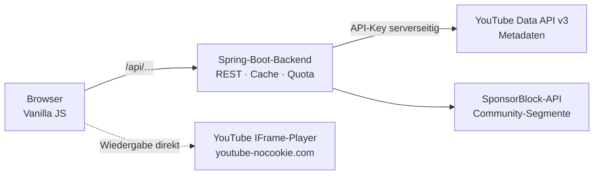
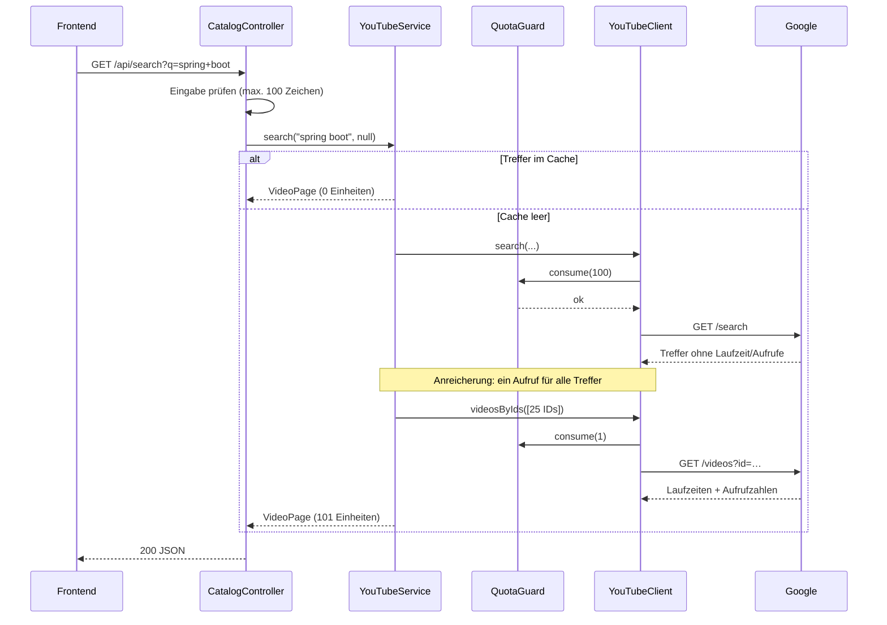
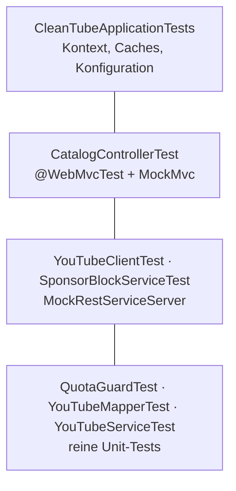

# Architektur

## 1. Überblick

CleanTube ist eine klassische dreischichtige Webanwendung mit einem entscheidenden Zusatz:
Das Backend ist nicht nur Datenlieferant, sondern **Torwächter** vor einer fremden API mit
knappem Kontingent.

Zwei Wege verlassen den Browser:

- **Metadaten** laufen über das eigene Backend. Nur so bleibt der API-Key geheim und das
  Kontingent kontrollierbar.
- **Der Videostrom** läuft direkt vom Browser zu YouTube. Das ist kein Kompromiss, sondern
  Voraussetzung: Videos über den eigenen Server zu leiten wäre technisch aufwendig, teuer und
  vor allem nicht erlaubt.

## 2. Schichten

| Paket | Verantwortung | Kennt |
|---|---|---|
| `api` | HTTP-Endpunkte, Eingabeprüfung, Ausnahme → Statuscode | `youtube`, `sponsorblock`, `model` |
| `youtube` | Google-API, Caching, Quota, Mapping | `model`, `config` |
| `sponsorblock` | Community-API für Sponsor-Abschnitte | `config` |
| `model` | DTOs der öffentlichen Schnittstelle | nichts |
| `config` | typsichere Konfiguration, Beans | nichts |

Die Abhängigkeiten zeigen ausschließlich nach innen. `model` kennt niemanden – dadurch lässt
sich jede Schicht einzeln testen.

### Anti-Corruption Layer

Die Roh-Antworten von Google liegen in `YouTubeResponses` und **verlassen das Paket
`youtube` nie**. Nach außen gehen ausschließlich die Typen aus `model`.

Das kostet eine Mapping-Klasse und bringt drei Dinge:

- Ändert Google ein Feld, ist genau eine Klasse betroffen (`YouTubeMapper`).
- Das Frontend sieht ein aufgeräumtes Modell statt fünf Vorschaubild-Größen und
  Zählern als JSON-Strings.
- Die Sonderfälle (verborgene Abonnentenzahlen, Livestreams ohne Laufzeit, gelöschte
  Playlist-Einträge) werden an *einer* Stelle behandelt.

## 3. Ablauf einer Suche

Der interessanteste Pfad, weil hier Quota, Cache und Anreicherung zusammenspielen:

Der Aufruf `videosByIds` bündelt **bis zu 50 IDs in einem einzigen Request**. Eine Schleife
mit einem Aufruf je Video würde dasselbe Ergebnis für das 50-Fache an Kontingent liefern.

## 4. Entwurfsentscheidungen

### 4.1 Der API-Key bleibt im Backend

*Alternative wäre gewesen:* Das Frontend ruft Google direkt auf – deutlich weniger Code.

*Dagegen spricht:* Ein Key im Browser ist über die Entwicklerwerkzeuge in zehn Sekunden
auslesbar. Dritte könnten ihn auf Kosten des Projekts verbrauchen. Google empfiehlt
serverseitige Verwendung ausdrücklich.

*Nebeneffekt:* Nur mit einem eigenen Backend sind zentrales Caching und eine Quota-Bremse
überhaupt möglich. Die Sicherheitsentscheidung ermöglicht die Kostenkontrolle.

### 4.2 Caching als fachliche Anforderung, nicht als Optimierung

Bei 10.000 Einheiten am Tag und 100 Einheiten je Suche wäre die App nach 100 Suchen tot.
Der Cache ist damit kein „nice to have“, sondern Voraussetzung für den Betrieb.

Die Lebensdauern sind nach Preis gestaffelt: Suchen 6 Stunden, günstige Abfragen 15 Minuten.
Der Suchschlüssel wird kleingeschrieben und getrimmt, damit Groß-/Kleinschreibung nicht
doppelt bezahlt wird.

### 4.3 Uploads-Playlist statt gefilterter Suche

Für „alle Videos eines Kanals“ gibt es zwei Wege:

| Weg | Kosten | Sortierung |
|---|---:|---|
| `search.list` mit `channelId` | 100 | nach Relevanz |
| `playlistItems.list` auf die Uploads-Playlist | 1 | chronologisch |

Jeder Kanal hat eine automatisch gepflegte Playlist (`contentDetails.relatedPlaylists.uploads`)
mit allen öffentlichen Videos. Der zweite Weg ist **hundertmal günstiger** und liefert die für
eine Kanalseite ohnehin passendere Sortierung.

### 4.4 `ChannelService` als eigene Bean

`YouTubeService#channelVideos` braucht die Kanaldaten, um an die Uploads-Playlist zu kommen.
Ein direkter Aufruf einer eigenen `@Cacheable`-Methode würde am Spring-Proxy vorbeilaufen –
der Cache griffe nicht (*Selbstaufruf-Problem*). Deshalb liegt der Kanal-Zugriff in einer
separaten Bean.

*Alternative wäre gewesen:* Selbstinjektion mit `@Lazy`. Funktioniert, ist aber schwerer zu
verstehen und macht Unit-Tests umständlich.

### 4.5 Laufzeiten als Sekundenzahl im Vertrag

Die DTOs führen `durationSeconds` als `Long`, nicht als `java.time.Duration`.

Wie Jackson eine `Duration` schreibt, hängt an globalen Schaltern
(`WRITE_DURATIONS_AS_TIMESTAMPS`, `WRITE_DATE_TIMESTAMPS_AS_NANOSECONDS`) – je nach
Einstellung ISO-String, Sekunden mit Nachkommastellen oder Millisekunden. Ein Schalter in
einer YAML-Datei, der still das API-Format ändert, ist eine schlechte Grundlage für einen
Vertrag. Eine schlichte Zahl ist eindeutig, im Browser ohne Zusatzbibliothek verwendbar und
im Quelltext sichtbar dokumentiert.

### 4.6 `exchange()` statt `retrieve()` bei SponsorBlock

Liegen für ein Video keine Segmente vor, antwortet SponsorBlock mit
`404 Not Found` und `Content-Type: text/plain` – nicht mit einer leeren JSON-Liste.

Mit `retrieve()` wird der Rumpf konvertiert, *nachdem* der Statuscode behandelt wurde; die
Konvertierung von `text/plain` nach `List<RawSegment>` scheitert dann. `exchange()` gibt die
Kontrolle über beides: erst Status prüfen, dann konvertieren.

> Dieser Fehler ist im Rauchtest gegen die echte API aufgefallen, nicht in den Unit-Tests.
> Der Regressionstest `behandelt_404_als_leer` bildet die reale Antwort inklusive
> `Content-Type` nach.

### 4.7 Injizierte `Clock`

`QuotaGuard` bekommt eine `Clock` als Bean statt `LocalDate.now()` aufzurufen. Nur so lässt
sich der nächtliche Reset des Kontingents testen, ohne einen Tag zu warten
(siehe `QuotaGuardTest#setzt_bei_tageswechsel_zurueck`).

### 4.8 Frontend ohne Framework und ohne Build-Schritt

Vier Ansichten, ein Hash-Router, kein Zustand jenseits der aktuellen Seite. React oder Vue
hätten hier mehr Werkzeugkette als Nutzen gebracht: `npm install`, Bundler, ein zweiter
Build-Schritt im Dockerfile.

So genügt `mvn spring-boot:run`. Spring Boot liefert `src/main/resources/static/` direkt aus,
ES-Module funktionieren nativ im Browser.

### 4.9 Kein `innerHTML`

Titel, Beschreibungen und Kanalnamen stammen von fremden Nutzern. Das Frontend baut den DOM
ausschließlich über `document.createElement` und `textContent`
(Helfer `el()` in `js/dom.js`) – der Standardschutz gegen Cross-Site-Scripting.

## 5. Fehlerbehandlung

Ausnahmen werden zentral im `ApiExceptionHandler` in Statuscodes übersetzt:

| Ausnahme | Status | Warum |
|---|---:|---|
| `ResourceNotFoundException` | 404 | Video oder Kanal existiert nicht |
| `QuotaExceededException` | **429** | Mengenbegrenzung, kein Programmfehler – verschwindet um Mitternacht |
| `YouTubeApiException` | 502 | Google hat gestört oder abgelehnt |
| Validierungsfehler | 400 | ungültige Parameter |
| alles Übrige | 500 | Stacktrace bleibt im Log |

`429` statt `500` beim Kontingent ist bewusst gewählt: Der Fehler liegt nicht am Code,
sondern an einer Mengengrenze, und er behebt sich von selbst. Das Frontend zeigt dazu einen
erklärenden Text statt einer generischen Fehlermeldung.

Zwei Stellen degradieren bewusst, statt zu scheitern:

- **Anreicherung der Suchtreffer.** Schlägt sie fehl, kommen die Treffer ohne Laufzeitangabe
  zurück. Die teure Suche ist bereits bezahlt – eine unvollständige Liste ist besser als eine
  Fehlerseite.
- **SponsorBlock.** Ist die Community-API gestört, kommt eine leere Liste. Das Video bleibt
  abspielbar, nur die Sprungmarken fehlen.

## 6. Datenschutz

Für eine Anwendung, die fremde Inhalte einbettet, sind das die relevanten Punkte:

| Maßnahme | Wirkung |
|---|---|
| Einbettung über `youtube-nocookie.com` | YouTube setzt Cookies erst beim Start der Wiedergabe |
| `referrerpolicy="no-referrer"` auf Vorschaubildern | Googles Bild-CDN erfährt nicht, welche Seite das Bild lädt |
| `<meta name="referrer" content="strict-origin-when-cross-origin">` | begrenzt, was YouTube über die aufrufende Unterseite erfährt |
| kein Analytics, keine Werbe-Skripte, keine Fremd-Fonts | keine Drittanbieter-Requests außerhalb der Wiedergabe |
| kein Login, keine Nutzerkonten | es fallen keine personenbezogenen Daten an |
| API-Key nur serverseitig | kein Geheimnis im Browser |

Vollständige Werbefreiheit im Player ist damit **nicht** erreicht und wird auch nicht
behauptet – die Begründung steht in [`werbefreiheit-und-recht.md`](werbefreiheit-und-recht.md).

## 7. Teststrategie

Alle 55 Tests laufen **offline**: kein API-Key, kein Netzwerk, kein Kontingentverbrauch.
Die HTTP-Schicht wird gegen `MockRestServiceServer` geprüft, die Web-Schicht mit `MockMvc`,
die Fachlogik mit Mockito.

Bewusst getestete Fälle, die im Betrieb tatsächlich auftreten:

- Kanal verbirgt seine Abonnentenzahl
- Livestream ohne feste Laufzeit
- gelöschtes Video als Platzhalter in einer Playlist
- Suchtreffer, der ein Kanal statt eines Videos ist
- Suchbegriff mit Leer- und Sonderzeichen (Prozentkodierung)
- Kontingent reicht nicht → kein HTTP-Aufruf, keine Buchung
- SponsorBlock antwortet `404 text/plain`

## 8. Mögliche Erweiterungen

| Idee | Nutzen | Aufwand |
|---|---|---|
| Abo-Liste lokal in `localStorage` | Kanäle folgen ohne Google-Konto | gering |
| Verlauf und „Später ansehen“ | Grundfunktionen ohne Anmeldung | gering |
| Cache in Redis statt im Arbeitsspeicher | Kontingent über mehrere Instanzen teilen | mittel |
| OAuth statt API-Key | echte Abos und Playlists des Nutzers | hoch |
| Untertitel-Suche | Sprung an die Fundstelle im Video | hoch |
